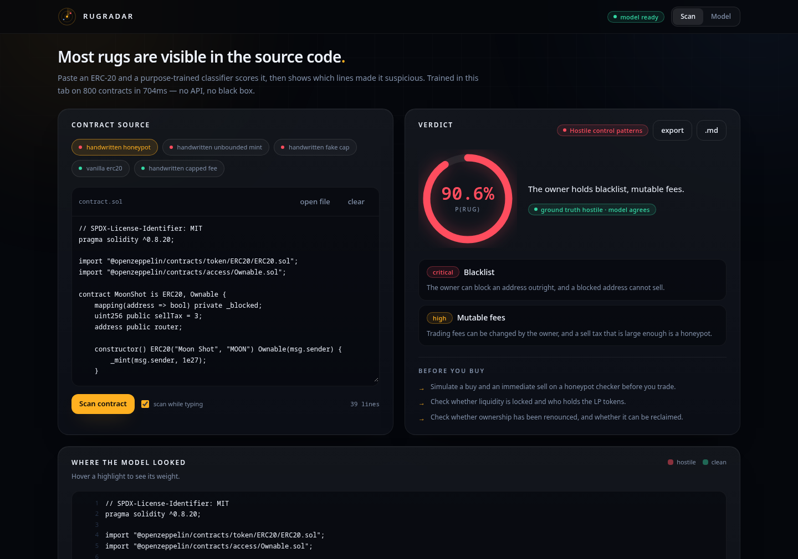

# RugRadar

**Read the contract before you buy.**

Most token rug-pulls are not clever. The contract hands the owner the power to
blacklist you, raise the sell tax, mint unlimited supply, or swap the logic out
after you buy — and all of that is sitting in plain text in the source, which
nobody reads.

RugRadar is a purpose-trained text classifier that reads ERC-20 source and
returns a rug-risk score, plus the specific identifiers that drove it. It is a
real NLP pipeline — tokeniser, TF-IDF vectoriser, logistic regression trained by
gradient descent — implemented from scratch, trained in the browser tab, and
explained feature by feature. No API, no model download, no network calls.



## Why a trained model instead of an LLM call

Contract source is text, the signal is lexical and structural (`blacklist`,
`setFees`, `onlyOwner`, `tx.origin`), and the decision is close to linearly
separable: *does an uncapped, owner-controlled setter exist?* A linear model on
sparse n-grams is the appropriate capacity for that, it trains in a few hundred
milliseconds, it never makes anything up, and — the important part — it exposes
exact per-feature attributions. You can see which lines moved the score.

An LLM would give a nicer paragraph and would not be able to tell you that.

## How it works

1. **Tokenise.** Comments and string literals are stripped first, so the model is
   forced onto code structure rather than author fingerprints. Identifiers are
   split on camelCase and snake_case, so `_isExcludedFromFee` and
   `isExcludedFromFee` collapse to the same signal. Features are unigrams plus
   within-line bigrams: `require` + `onlyOwner` + `blacklist`, without a parser.
2. **Weight.** Sublinear term frequency, smoothed inverse document frequency, a
   document-frequency floor, and L2 normalisation so contract length cannot
   dominate the vector.
3. **Classify.** Logistic regression, full-batch gradient descent with an L2
   penalty and class-balanced loss weights, 240 epochs.
4. **Attribute.** Contribution of each feature is `weight × value`, which maps
   back onto source spans and drives the highlighting.

## The corpus, and why it is de-biased

There is no open labelled dataset for "is this token hostile", so
`src/ml/corpus.ts` generates one from real patterns: OpenZeppelin-style
baselines, distractors that look alarming but are safely capped, and hostile
patterns that hand the owner unbounded control.

The first version of this scored 99% and was worthless. It had learned that
benign contracts name a parameter `newFee` while hostile ones name it
`account` — a naming habit of the generator, not a security property. Both
classes now draw identifiers from shared pools, benign contracts contain loops
and fee setters too, and the model is forced onto the vocabulary that actually
matters. That change is the difference between a demo and a detector.

## Results

Trained on 640 contracts, evaluated on 160 held out from the same generator:

| metric | value |
| --- | --- |
| accuracy | 100% |
| precision (rug) | 100% |
| recall (rug) | 100% |

Treat that as an upper bound — the test split shares a distribution with the
training data, so it partly measures the generator. The honest number comes from
five contracts written by hand, which the model never saw:

| contract | truth | p(rug) | result |
| --- | --- | --- | --- |
| hand-written honeypot (blacklist + mutable sell tax) | rug | 0.91 | caught |
| hand-written unbounded mint + trading gate | rug | 0.83 | caught |
| hand-written nominal cap that permits 100% | rug | 0.28 | **missed** |
| hand-written capped fee | clean | 0.11 | passed |
| vanilla fixed-supply ERC-20 | clean | 0.03 | passed |

The miss is the interesting one, and it is left in deliberately. The contract
contains `require(newFee <= MAX_FEE)`, which looks like a cap, but `MAX_FEE` is
`10_000` basis points — 100%. A bag-of-n-grams model cannot evaluate what a
constant is worth, so it credits the presence of a cap check. Closing that gap
requires parsing and constant propagation, not a bigger model.

## What this does not do

- Not a honeypot detector. Real honeypot detection means simulating a buy and an
  immediate sell; this narrows the search space before you get there.
- Not a security audit. No parser, no control-flow analysis, no bytecode
  reasoning.
- Not financial advice, and the score is a probability from a generated corpus,
  not a verdict.

## Run it

```bash
npm install
npm run dev
```

Then open `http://localhost:5173`.

`node_modules` is already installed in this working copy, so the app runs
without a network install today. Once you have network access, run
`npm install` (or `npm ci`) to refresh from `package-lock.json`.

## Using it

The app has two views, switchable from the header: **Scan** (the tool) and
**Model** (the training run and evaluation). They are deep-linkable at `#scan`
and `#model`.

- **Paste or drop.** Paste Solidity, drop a `.sol` file onto the editor, or start
  from one of the five hand-written sample contracts. The chips are colour-coded
  by ground truth, and the verdict card says whether the model agrees with it.
- **Scan.** The button, `Cmd`/`Ctrl` + `Enter`, or leave *scan while typing* on
  and the verdict updates as you edit.
- **Read the attribution.** Hover any highlight under *Where the model looked* to
  see that identifier's weight. Open *raw feature weights* for the full
  attribution bars and the nearest contracts in the training set — click one to
  load it for comparison.
- **Export.** *export* puts a full Markdown write-up on the clipboard, and `.md`
  downloads it: verdict, powers found, attribution table, nearest neighbours,
  and the source.

The model card in the UI shows the live training run, the confusion matrix, the
hand-written check, and the largest learned weights.

Headless check that the model actually learns:

```bash
npm run selftest
```

## Testing

`npm run selftest` trains the model and prints the held-out metrics and the
hand-written results, so a change to the corpus or the trainer is visible
immediately.

`npm run uitest` drives the real UI in a browser over the Chrome DevTools
Protocol: it waits for training, switches views, clicks a sample, types new
source into the editor and lets auto-scan fire, then fails on any uncaught
error. Start the app and a debuggable Chrome first:

```bash
npm run dev
google-chrome --headless=new --remote-debugging-port=9222 \
  --user-data-dir=/tmp/cdp http://127.0.0.1:5173/#scan
npm run uitest
```

## Layout

```
src/ml/featurize.ts   tokeniser, identifier splitting, TF-IDF vectoriser
src/ml/logreg.ts      logistic regression, incremental trainer, metrics
src/ml/corpus.ts      synthetic corpus generator
src/ml/handwritten.ts hand-written out-of-distribution evaluation set
src/ml/pipeline.ts    train/test split, prediction, attribution, neighbours
src/ml/explain.ts     maps attributions onto plain-English powers
src/components/       workbench, model card, UI primitives
scripts/selftest.ts   headless training + evaluation report
```

## Shipping it

It is a static Vite app with no backend, so any static host works:

```bash
npm run build          # outputs dist/
npm run preview        # sanity-check the production build locally
```

- **Vercel / Netlify** — import the repo; the defaults are already correct
  (build `npm run build`, output `dist`).
- **GitHub Pages** — `base` is set to `./` in `vite.config.ts`, so the build
  works from a project subpath without changes. Publish `dist/`.

Two things to set once you know the URL: point `og:image` and `twitter:image` in
`index.html` at the absolute URL of the screenshot (crawlers ignore relative
image paths), and delete `node_modules/` before zipping the folder if you are
sending it as an archive rather than a repo.
